# Architecture

> **Status:** Stage 2 — In Progress  
> **Related:** [PROPOSAL.md](https://github.com/markthesuperpro/RDK-X5-A.Q.A.R-Stage2/blob/main/PROPOSAL.md) · [README.md](https://github.com/markthesuperpro/RDK-X5-A.Q.A.R-Stage2/blob/main/README.md)

## 1. System Flow

```mermaid
flowchart LR
    %% INPUTS
    subgraph INPUTS["Inputs"]
        direction TB
        LIDAR["LiDAR"]
        IMU["IMU"]
        CAMERA["Camera"]
        JOYSTICK["Joystick"]
    end

    %% RDK X5
    subgraph RDK["RDK X5 — High-Level Processing"]
        direction TB

        subgraph NAV["Autonomous Navigation"]
            direction TB
            SLAM["SLAM<br/>Mapping & Localization"]
            NAV2["Nav2<br/>Path Planning & Navigation"]
            SLAM -->|"Map / Localization / TF"| NAV2
        end

        subgraph AI["AI Perception"]
            direction TB
            MODEL["AI Model"]
            OUTPUT["Output Node"]
            MODEL --> OUTPUT
        end
    end

    %% ESP32
    subgraph ESP["ESP32 — Low-Level Control"]
        direction TB
        NAV_IN["Navigation Command Input"]
        JOY_IN["Joystick Input"]
        MUX["Command Arbitration<br/>Manual / Autonomous / Safety"]
        GAIT["Gait & Servo Control Firmware"]

        NAV_IN --> MUX
        JOY_IN --> MUX
        MUX --> GAIT
    end

    %% OUTPUTS
    subgraph OUTPUTS["Physical Outputs"]
        direction TB
        SERVOS["Servos"]
        AUX["Other Event-Driven Outputs"]
    end

    %% NAVIGATION ROUTE
    LIDAR -->|"Laser Scan"| SLAM
    IMU -->|"Orientation / Angular Velocity"| SLAM
    NAV2 -->|"/cmd_vel via communication bridge"| NAV_IN
    GAIT --> SERVOS

    %% CAMERA / AI ROUTE
    CAMERA -->|"Image Frames"| MODEL
    OUTPUT --> AUX

    %% MANUAL CONTROL ROUTE
    JOYSTICK --> JOY_IN

    %% STYLING
    classDef sensor fill:#dbeafe,stroke:#2563eb,color:#172554
    classDef compute fill:#ede9fe,stroke:#7c3aed,color:#2e1065
    classDef control fill:#ffedd5,stroke:#ea580c,color:#431407
    classDef output fill:#dcfce7,stroke:#16a34a,color:#14532d

    class LIDAR,IMU,CAMERA,JOYSTICK sensor
    class SLAM,NAV2,MODEL,OUTPUT compute
    class NAV_IN,JOY_IN,MUX,GAIT control
    class SERVOS,AUX output
```

The RDK X5 handles perception and navigation and mapping, while the ESP32 handles low-level locomotion and hardware control.

The execution flow is:

1. **Sensing:** Sensors collect orientation, environmental and visual information.
2. **Processing:** RDK X5 receives sensor data and performs calculations.
3. **Navigation:** SLAM provides mapping/localization of data, while Nav Firmware calculates movements.
4. **Actuation:** The ESP32 translates high-level ROS2 movement commands into quadruped locomotion.

## 2. Components & Responsibilities

| Component | Runs on | Responsibility | Interfaces |
|---|---|---|---|
| ESP32 Firmware | ESP32 | Motor control and sensor detection | Hardware I/O, ROS2 command protocol |
| ESP32 Bridge | RDK X5 | Connects to ESP32 hardware with ROS 2 | Wi-Fi, ROS 2 |
| Camera Bridge | Camera chip | Transfers camera frames into the ROS 2 environment | Image stream |
| IMU | IMU board | Estimates robot orientation and direction | IMU, TF |
| SLAM | RDK X5 | Builds the map | `/map`, TF |
| Nav Firmware | RDK X5 | controls autonomous navigation | Map, `/cmd_vel` |
| Lidar | Lidar chip | Sends sensory data to the main ESP32 for transmittion, provide RDK X5 with /Laser_scan node | `/scan` |
| Motor Controller | ESP32 | Converts movement commands into leg movements | Movement command packets |

**Implementation status:**
- Implemented: ESP32 Firmware, ESP32 Bridge, Camera Bridge, Motor Controller
- In progress: IMU, SLAM, Nav Firmware, Lidar

## 3. ROS 2 Interfaces

### Topics

| Topic | Message Type | Publisher → Subscriber | Purpose |
|---|---|---|---|
| `/imu/data` | `sensor_msgs/msg/Imu` | ESP32 → RDK X5 | Orientation measurements |
| `/camera/image_raw` | `sensor_msgs/msg/Image` | Camera Bridge → Perception | Camera frames |
| `/scan` | `sensor_msgs/msg/LaserScan` | Lidar → SLAM / Nav Firmware | range measurement |
| `/map` | `nav_msgs/msg/OccupancyGrid` | SLAM → Nav Firmware | Environment map |
| `/cmd_vel` | `geometry_msgs/msg/Twist` | Nav Firmware → ESP32 Bridge | Linear velocity commands |

### Actions & Services

| Interface | Type | Purpose |
|---|---|---|
| `/servo/angle` | `std_msgs/msg/String` | Requests FORWARD/BACKWARD/LEFT/RIGHT control from the robot |

### Communication Details

- **Transport:** [Wi-Fi]
- **Message format:** [ROS2 Protocol]
- **QoS:** Reliable

## 4. Localization & Calibration

### Coordinate Frames

The robot uses the following TF hierarchy:

`scan → map → cmd_vel → servo/angle`

- `scan`: Lidar scan node
- `map`: environment map
- `cmd_vel`: velocity command
- `servo/angle`: publish to robot 

### State Estimation

**Sensor calibration:**
- IMU: Gyroscope bias and accelerometer calibration.
- Camera: Intrinsic parameters and mounting transformation.
- Range sensors: Measurement accuracy and mounting position.
- Odometry: Motion estimation and reference-frame consistency.

## 5. Compute Allocation

| Compute Unit | Assigned Workloads | Reason |
|---|---|---|
| ESP32 | Motor control, RDK X5 -> Motor, Camera bridge | Handles low-level hardware operations and publishes data to RDK X5 |
| RDK X5 CPU | ROS 2, sensor processing, SLAM, Nav Firmware | Handles system orchestration and navigation |
| RDK X5 BPU | AI detection inference model | Accelerates detection model inference |

**Resource considerations:**
- CPU utilization: Measured
- Memory usage: Measured
- Inference latency: Measured if applicable
- Sensor processing rates: target

## 6. Safety & Reliability

### Failure Handling

| Failure | Detection | Expected Response |
|---|---|---|
| Camera disconnected | Frame/Network timeout | Possible network drops |
| Localization failure | Invalid pose / estimator status | Suspend autonomous navigation |
| Navigation failure | Failed navigation action | Stop autonomous movement and report failure |
