# RDKx5-Autonomous-Quadruped-Monitoring-Robot — Stage 2 Project Proposal

A quadruped walking robot, made for monitoring elders, powered by esp32 and RDKx5 and compacted with IMU, lidar and camera.

| Field | Details |
|---|---|
| **Participant** | Mark |
| **Hardware** | D-Robotics RDK X5 |
| **Controller** | ESP32 |
| **Software** | ROS 2 / TROS / ESP32 Firmware |
| **Status** | Stage 2 - In Development |
| **Repository** | https://github.com/markthesuperpro/rdk-x5-stage1 |
| **Roadmap** | [ROADMAP.md](https://github.com/markthesuperpro/rdk-x5-stage1/blob/main/ROADMAP.md) |
| **Proposal Version:** | 1.0 |
| **Last Updated** | 26-11-2026 |

## 1. Summary

In many households, eldery require consistent care and monitoring for their safety. However, not everyone have all the time to care for their eldery. That is why we created a quadruped walking robot that can monitors your elders for you in real-time. The robot is powered by RDKx5 and ESP32 as the motor driver. In current status, it is able to recieve and register commands from ros2 to its motor. This allows it to navigate to any area and monitor eldery with great effectiveness.

## 2. Problem & Intended Use

- **Problem:** Many households have issues with the lack of time to care for their eldery
- **Target User:** People who need help in monitoring eldery
- **Operating Environment:** Indoor
- **Objective:** Monitors and assists eldery

## 3. Proposed Solution

The quadruped robot is fitted with IMU and Lidar, in which allows it to sense its environment. A camera is also attached to the robot to be able to monitor the eldery current status. Next, the RDK X5 will run a custom program using each of the nodes data (Eg. /imu, /camera/raw -> Model -> AI node, etc) and calculate its decision logically. For example, if the robot camera detects an eldery on the floor, it could signal for the eldery in question if they have fallen or not. Finally, the robot will publish data to the ESP32 node as movement commands. 

## 4. Human-Robot Interaction

1. User initializes the robot
2. robot initialized its programmed scripts
3. robot established connections with RDK X5 via publisher and subscriber nodes
4. RDK X5 recieves and computes the data
5. RDK X5 sent movement commands
6. Robot recieves commands and executes tasks

## 5. Implementation Status

| Status | Component | Description / Evidence |
|---|---|---|
| Done | ESP32 & Servo motors | ESP32 is able to recieve ROS2 commands and send servo motors signals for movements. |
| Done | RDK X5 | Able to communicate directly with components |
| In Progress | Camera | Able to publish data, however can't be directly connect to other nodes yet |
| Planned | Lidar | publish /Laser_scan data to RDK X5 for mapping environment |
| Planned | IMU board | publish /imu data to RDK X5 for mapping environment |
| Planned | Joy stick | publish /joystick data to RDK X5 for manual control |

## 6. System Overview

**High-Level Data Flow**

```mermaid
flowchart LR
    %% INPUTS
    subgraph INPUTS["Inputs"]
        direction TB
        LIDAR["LiDAR"]
        IMU["IMU"]
        CAMERA["Camera"]
        JOYSTICK["Joystick"]
    end

    %% RDK X5
    subgraph RDK["RDK X5 — High-Level Processing"]
        direction TB

        subgraph NAV["Autonomous Navigation"]
            direction TB
            SLAM["SLAM<br/>Mapping & Localization"]
            NAV2["Nav2<br/>Path Planning & Navigation"]
            SLAM -->|"Map / Localization / TF"| NAV2
        end

        subgraph AI["AI Perception"]
            direction TB
            MODEL["AI Model"]
            OUTPUT["Output Node"]
            MODEL --> OUTPUT
        end
    end

    %% ESP32
    subgraph ESP["ESP32 — Low-Level Control"]
        direction TB
        NAV_IN["Navigation Command Input"]
        JOY_IN["Joystick Input"]
        MUX["Command Arbitration<br/>Manual / Autonomous / Safety"]
        GAIT["Gait & Servo Control Firmware"]

        NAV_IN --> MUX
        JOY_IN --> MUX
        MUX --> GAIT
    end

    %% OUTPUTS
    subgraph OUTPUTS["Physical Outputs"]
        direction TB
        SERVOS["Servos"]
        AUX["Other Event-Driven Outputs"]
    end

    %% NAVIGATION ROUTE
    LIDAR -->|"Laser Scan"| SLAM
    IMU -->|"Orientation / Angular Velocity"| SLAM
    NAV2 -->|"/cmd_vel via communication bridge"| NAV_IN
    GAIT --> SERVOS

    %% CAMERA / AI ROUTE
    CAMERA -->|"Image Frames"| MODEL
    OUTPUT --> AUX

    %% MANUAL CONTROL ROUTE
    JOYSTICK --> JOY_IN

    %% STYLING
    classDef sensor fill:#dbeafe,stroke:#2563eb,color:#172554
    classDef compute fill:#ede9fe,stroke:#7c3aed,color:#2e1065
    classDef control fill:#ffedd5,stroke:#ea580c,color:#431407
    classDef output fill:#dcfce7,stroke:#16a34a,color:#14532d

    class LIDAR,IMU,CAMERA,JOYSTICK sensor
    class SLAM,NAV2,MODEL,OUTPUT compute
    class NAV_IN,JOY_IN,MUX,GAIT control
    class SERVOS,AUX output
```

**Compute Allocation**

| Hardware | Responsibility |
|---|---|
| RDK X5 CPU | ROS 2 integration, navigation |
| RDK X5 BPU | AI inference |
| ESP32 | Motor Control |

## 7. Objectives & Success Criteria

| Objective | Success Criteria | Verification |
|---|---|---|
| Sensor integration | 25-50 FPS | Logs / Visualization |
| Mapping | 40-60% accurancy | Map / Recorded runs |
| Navigation | Able to navigate accross different room enviroments | Repeated navigation tests |
| AI inference | 10-20 FPS (in success in spotting human) | BPU benchmarks |

## 8. Scope & Priorities

| Priority | Capability | Expected Result |
|---|---|---|
| Must | Motor Control | FORWARD,BACKWARD,LEFT,RIGHT |
| Must | Map Navigation | Create map, follow map |
| Should | Detect human via camera | Use AI interface and detect human |
| Should | Detect objects via Lidar | Get lidar as /Laser_scan node |

## 9. Hardware & Software Requirements

**Hardware:**
| Component | Qty. | Model / Interface | Purpose |
|---|---:|---|---|
| RDK X5 | 1 | RDK OS, TROS | Main computing platform |
| ESP32 | 1 | ESP 32 DEV | Low-level motor controller |
| Camera | 1 | ESP32 connected Camera | Visual perception |
| IMU | 1 | - | Orientation |
| Lidar | 1 | - | Environmental sensing |
| Servo Motors | 4 legs x 3 motors | Mini-servo | Locomotion |

**Software Stack:** <ROS 2 distribution, TROS version, SLAM framework, Nav2, AI runtime, firmware and other important dependencies.>
| Component | Version | Purpose |
|---|---|---|
| TROS / ROS 2 | Humble | Main ROS |
| SLAM | LATEST | Mapping |
| Nav Firmware | Humble | Navigation |

## 10. Development Roadmap

| Milestone | Planned Work | Completion Evidence |
|---|---|---|
| 1. Integration | Robot Hardware (e.g. Servos) | Visual Movements |
| 2. Perception | Sensor and Camera processing | sensor outputs logs |
| 3. Autonomous Navigation | SLAM and Nav Firmware | Successful navigation tests |
| 4. Optimization | BPU inference and performance | Benchmarks Screenshots |
| 5. Final Demonstration | Checking and Integration> | Public demonstration - E.g. Video, Docs, etc. |

## 11. Definition of Done

Robot musts can:
 - Autonomous Movements
 - Real-time detection
 - Demonstate navigation capabilities
 - Shows monitoring effectiveness

# Requirements Traceability

| Official Stage 2 requirement | Supporting deliverable |
|---|---|
| Operating scenario and constraints | [PROPOSAL.md](https://github.com/markthesuperpro/rdk-x5-stage1/blob/main/PROPOSAL.md) |
| Intended users and interaction | [PROPOSAL.md](https://github.com/markthesuperpro/rdk-x5-stage1/blob/main/PROPOSAL.md) |
| Core AI capabilities and innovation | [PROPOSAL.md](https://github.com/markthesuperpro/rdk-x5-stage1/blob/main/PROPOSAL.md) |
| Architecture and data flow | [ARCHITECTURE.md](https://github.com/markthesuperpro/rdk-x5-stage1/blob/main/ARCHITECTURE.md) |
| Module responsibilities and failure modes | [ARCHITECTURE.md](https://github.com/markthesuperpro/rdk-x5-stage1/blob/main/ARCHITECTURE.md) |
| BPU / CPU | [ARCHITECTURE.md](https://github.com/markthesuperpro/rdk-x5-stage1/blob/main/ARCHITECTURE.md) |
| ROS 2 graph and interfaces | Architecture diagrams |
| BOM and engineering timeline | [ENGINEERING_PLAN.md](https://github.com/markthesuperpro/rdk-x5-stage1/blob/main/docs/ENGINEERING_PLAN.md) / [ROADMAP.md](https://github.com/markthesuperpro/rdk-x5-stage1/blob/main/ROADMAP.md) |
| risks and mitigation | [ENGINEERING_PLAN.md](https://github.com/markthesuperpro/rdk-x5-stage1/blob/main/docs/ENGINEERING_PLAN.md) |
| Repository structure | [GitHub](https://github.com/markthesuperpro/rdk-x5-stage1) |
| Community post | [Discord](https://discord.com/channels/1300358874280230994/1503706103752429618/threads/1565947368782831757) |

## References & Evidence

- **Development Roadmap:** [ROADMAP.md](https://github.com/markthesuperpro/rdk-x5-stage1/blob/main/ROADMAP.md)
- **Demonstration:** [VIDEO] #Todo
- **Technical Evidence:** [Evidence](https://github.com/markthesuperpro/rdk-x5-stage1/tree/main/evidence)
- **RDK repo:** [Official Robotics Dream Keeper Challenge — Stage 2](https://github.com/D-Robotics/Robotics-Dream-Keeper-Challenge-Winter)
- **RDK Documention:** [RDK X5 documentation](https://developer.d-robotics.cc/)
